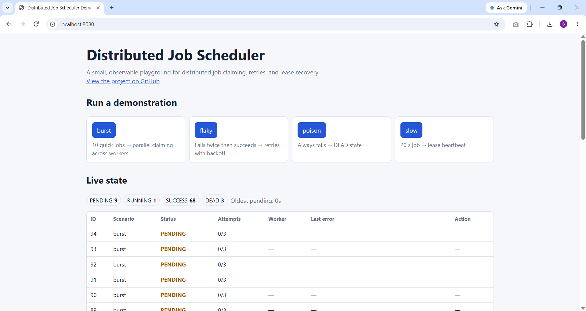
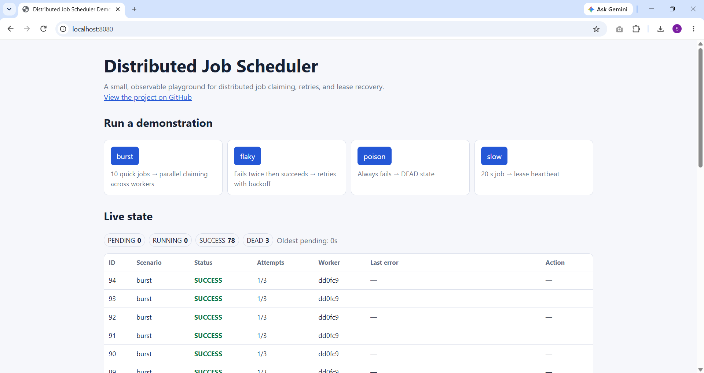
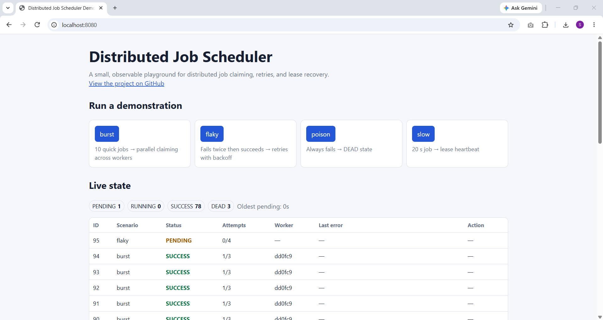
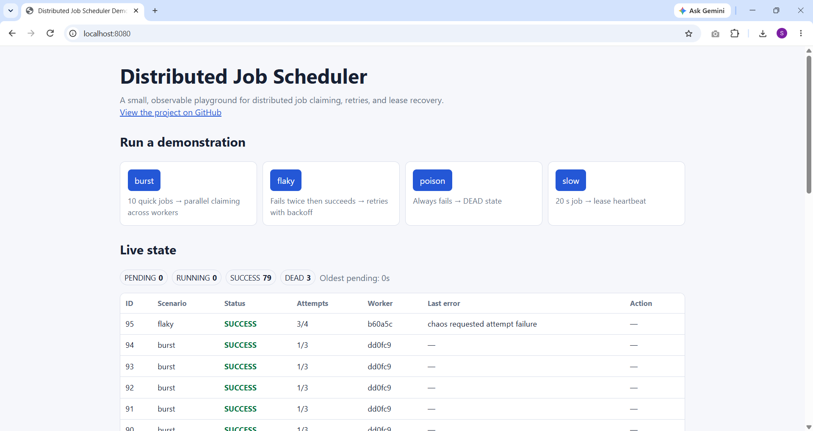
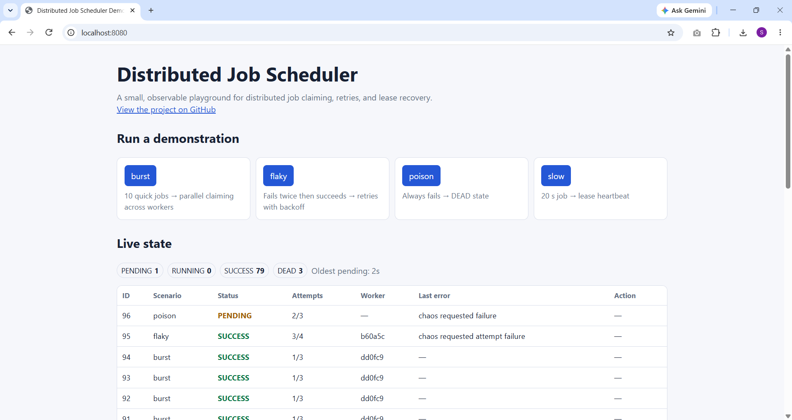
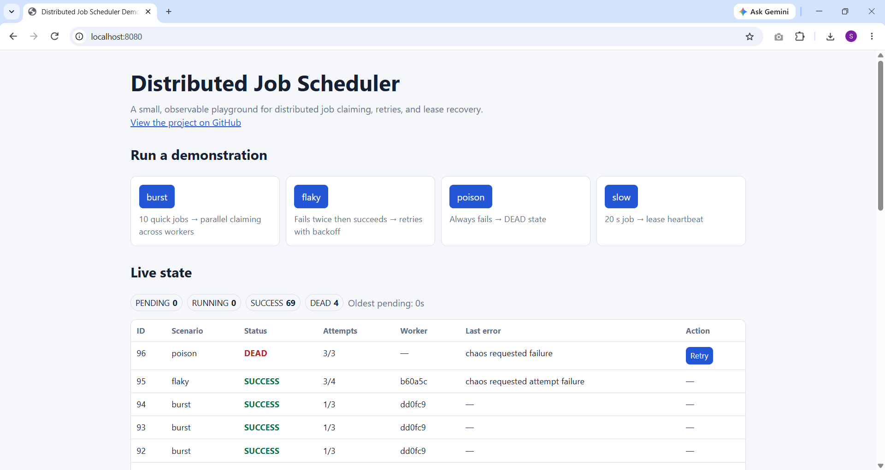
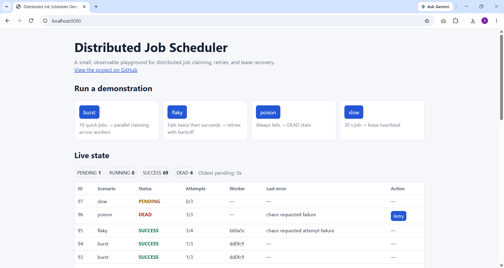
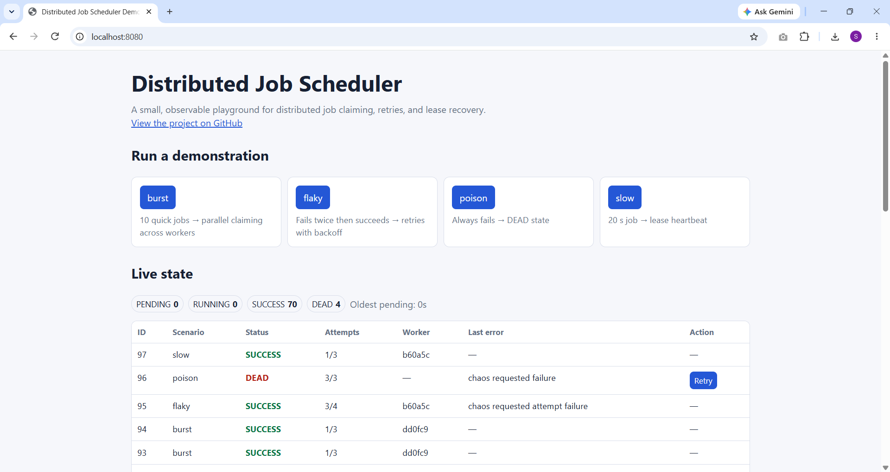
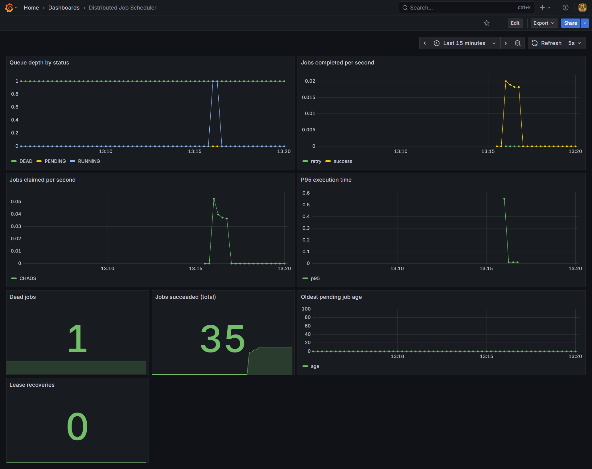
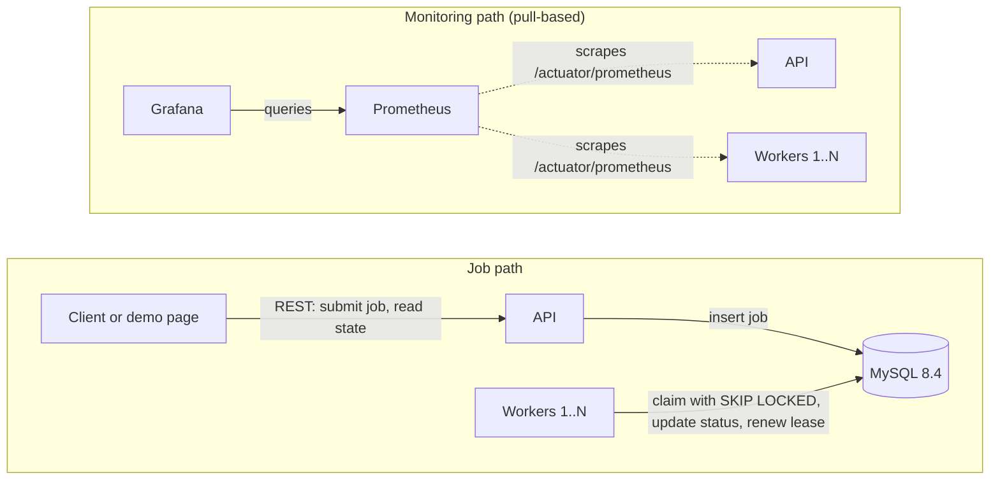

# Distributed Job Scheduler

[](https://github.com/dev-saheblalshaikh/distributed-job-scheduler/actions/workflows/ci.yml)

A small background-job platform in the spirit of Quartz, JobRunr and Sidekiq, built to understand how distributed job processing really works: clients submit jobs over REST, jobs are stored in MySQL, several workers claim and run them safely, failures are retried with backoff, crashed workers are recovered, and everything is observable in Prometheus and Grafana.

It is a learning project, not a new invention. The value is in the design decisions and in being able to defend each of them (see [Design decisions](#design-decisions) and [Known limitations](#known-limitations)).

**Stack:** Java 25, Spring Boot 4.1, Spring JdbcTemplate, MySQL 8.4, Flyway, Docker Compose, Micrometer, Prometheus, Grafana, Testcontainers, GitHub Actions.

## Demo

**Video (about 90 seconds):**

https://github.com/user-attachments/assets/2f4da762-2c18-4832-984d-6b8636aac74b

A built-in demo page lets you run four fixed scenarios and watch the queue live. Each scenario maps to one idea in the design:

| Scenario | What it does | What it shows |
|---|---|---|
| `burst` | 10 quick jobs | Parallel claiming across workers (`SKIP LOCKED`) |
| `flaky` | Fails twice, then succeeds | Retries with exponential backoff |
| `poison` | Always fails | Dead-letter state and manual retry |
| `slow` | A 20-second job | Lease heartbeat keeps a slow job owned |

| Queued | Claimed and completed |
|---|---|
|  |  |
|  |  |
|  |  |
|  |  |

Grafana dashboard (throughput, queue depth, p95 execution time, dead jobs, lease recoveries):



The demo API is **opt-in** (`DEMO_ENABLED=true`) and safe to expose by design: only four fixed scenarios exist (no user-supplied job type, payload or sleep time), each client is limited to one scenario call per 3 seconds and 30 per hour, at most 60 demo jobs can be pending or running at once, and demo jobs are deleted automatically after one to three hours. The regular `/api/**` endpoints have **no authentication** and must never be exposed publicly.

## Architecture



Solid arrows show job traffic through MySQL. Dotted arrows show metrics that Prometheus pulls; Prometheus and Grafana never touch the database. The API and the workers are the same services in both parts.

Code layout: `api` (controllers, DTOs, service) -> `common` (job model and repository) <- `worker` (poller, heartbeat, recovery and pluggable handlers). Public demo code lives in `demo`.

Job lifecycle: `PENDING` -> `RUNNING` -> `SUCCESS`, or back to `PENDING` with a later `run_at` after a retryable failure, or `DEAD` once attempts are used up.

## Design decisions

- **Jobs live in MySQL, not in the request.** The API saves the job and answers immediately. Work survives crashes, status and errors are visible, workers scale independently of the API, and retries are possible because the job is data. Trade-off: polling adds about one second of latency, and a database queue suits moderate throughput; a broker such as Kafka or RabbitMQ scales further but adds infrastructure.
- **Claiming uses `SELECT ... FOR UPDATE SKIP LOCKED`** inside one transaction, followed by an `UPDATE` to `RUNNING` and a commit. Workers take different rows in parallel without waiting or duplicates. The handler runs after the commit so no database locks are held during slow work. Trade-off: strict FIFO order is not guaranteed.
- **Ownership guard (fencing).** Success and failure updates only apply when `status='RUNNING' AND locked_by=<me>`. A slow or presumed-dead worker cannot overwrite the state of the worker that now owns the job.
- **Leases and heartbeats.** Each claim gets a lease (30 s). A heartbeat renews it while the worker is alive. If the worker dies, the lease expires and a recovery task requeues the job (or marks it `DEAD` if attempts are used up). A lease separates "slow" from "dead", which a fixed timeout cannot. The crashed attempt counts toward `maxAttempts`, so a poison job that keeps killing workers cannot loop forever.
- **Retries with exponential backoff and jitter.** Delays grow from 2 s up to a 300 s cap with random jitter so jobs that failed together do not retry together. The delay is just a future `run_at`, so no extra scheduler is needed. Unknown job types are non-retryable and go straight to `DEAD`.
- **Idempotency keys.** A unique `idempotency_key` makes client retries safe: the first request returns `201`, a repeat returns the existing job with `200`. The database constraint is the real guard against races.
- **All timestamps are UTC** (`UTC_TIMESTAMP()`, `LocalDateTime.now(ZoneOffset.UTC)`, JVM `-Duser.timezone=UTC`), so laptops, containers and servers in different zones agree.
- **JdbcTemplate instead of JPA** for full control over the locking SQL, and **Flyway** so the schema is versioned in git.

## Delivery guarantees

Claiming is exactly-once (`SKIP LOCKED` plus the transaction). Execution is **at-least-once**: if a worker is only slow or cut off from the database, its lease can expire and another worker re-runs the job. The ownership guard prevents the late worker from overwriting the result, but it cannot undo side effects the handler already caused. **Handlers must therefore be idempotent**; `context.jobId()` is available as a de-duplication key. This is the same trade-off made by SQS, Sidekiq and Quartz.

## Quick start

Requirements: Docker with Compose v2 for running; Java 25 and Maven for tests.

**Run the stack without the demo page's API** (API, workers, MySQL, Prometheus, Grafana):

```bash
docker compose up --build --scale worker=3 -d
```

The page at `http://localhost:8080` loads but reports that the demo is disabled. The API health is at `/actuator/health` and Swagger UI at `/swagger-ui.html`.

**Run the full demo locally** (the production overlay enables the demo API):

```bash
cp deploy/.env.example deploy/.env       # then edit the three passwords (letters and digits only)
docker compose --env-file deploy/.env -f docker-compose.yml -f deploy/docker-compose.prod.yml up -d --build --scale worker=3
```

Windows PowerShell, creating the env file:

```powershell
Set-Content -Path deploy\.env -Encoding ascii -Value "MYSQL_ROOT_PASSWORD=ChangeMe12345"
Add-Content -Path deploy\.env -Encoding ascii -Value "MYSQL_PASSWORD=ChangeMe67890"
Add-Content -Path deploy\.env -Encoding ascii -Value "GF_SECURITY_ADMIN_PASSWORD=ChangeMe54321"
```

Then open `http://localhost:8080` (demo page) and `http://localhost:3000` (Grafana, user `admin`). Stop with the same compose command and `down` instead of `up ...`.

## API examples

```bash
curl -X POST http://localhost:8080/api/jobs -H 'Content-Type: application/json' -d '{"jobType":"EMAIL","payload":{"to":"student@example.com"}}'
curl http://localhost:8080/api/jobs/1
curl 'http://localhost:8080/api/jobs?status=SUCCESS&limit=20'
curl 'http://localhost:8080/api/jobs?status=DEAD'
curl -X POST http://localhost:8080/api/jobs/1/retry
```

The optional `maxAttempts` field accepts 1 to 10 (default 3). `POST /api/jobs/{id}/retry` requeues a `DEAD` job and resets its attempts (`409` if the job is not `DEAD`, `404` if it does not exist). Add a new job type by creating one `JobHandler` component with a unique `type()`; the registry discovers it automatically. The built-in handlers are `EMAIL` (logs) and `CHAOS` (sleeps or fails on purpose, used by tests and the demo).

## Observability

Prometheus is at `http://localhost:9090`, Grafana at `http://localhost:3000` (provisioned datasource and dashboard) and application metrics at `/actuator/prometheus`. Metrics follow Rate, Errors, Duration plus queue health: `jobs_claimed_total`, `jobs_completed_total{job_type,result}`, `job_execution_seconds`, `jobs_lease_recovered_total`, `jobs_queue_depth{status}`, `jobs_oldest_pending_age_seconds` and `demo_rejected_total{reason}`. Labels are limited to job type, status and result: worker and job ids are never labels because each distinct value would create a new time series.

```promql
jobs_queue_depth{status="PENDING"}
sum by (result) (rate(jobs_completed_total[5m]))
histogram_quantile(0.95, sum by (le) (rate(job_execution_seconds_bucket[5m])))
```

Worker containers publish no host ports; Prometheus discovers them through Docker DNS, so scaling workers needs no configuration change.

## Testing

`mvn test` runs unit tests and integration tests against a real MySQL via Testcontainers (Docker must be running). Notable tests:

- **Parallel claiming** is proven deterministically: three jobs wait on a `CyclicBarrier(3)`, which only trips if three workers really hold three different jobs at once. No assumptions about scheduling fairness.
- **Exactly-once claiming:** 300 jobs, 3 workers in parallel, every job `SUCCESS` with exactly one attempt.
- **Heartbeat** has a negative control: with the heartbeat disabled the job is requeued, which proves the positive test can fail.
- **Retries, backoff, dead state, ownership guard, idempotency and the demo limits** have their own tests.
- **Page contract:** the demo page is checked to be self-contained (no external requests, no `innerHTML`) and to use the field names the server really sends.

### Smoke test against a running stack

Checks Prometheus targets, the Grafana dashboard, metric deltas for burst, slow, failing and unknown-type jobs, and optionally kills a worker mid-job and verifies recovery.

```powershell
# Windows PowerShell, local stack
powershell -ExecutionPolicy Bypass -File scripts\smoke-test.ps1 -IncludeCrashTest
```

```bash
# Linux with PowerShell 7, production compose files (see deploy/README.md)
set -a; source deploy/.env; set +a
pwsh scripts/smoke-test.ps1 -IncludeCrashTest -ComposeFiles "--env-file","deploy/.env","-f","docker-compose.yml","-f","deploy/docker-compose.prod.yml"
```

The smoke test expects three workers (four Prometheus targets in total).

## Performance

Run the repeatable benchmark from Windows PowerShell after stopping the normal stack:

```powershell
docker compose down
powershell -ExecutionPolicy Bypass -File scripts\run-benchmarks.ps1 -Matrix
```

The benchmark inserts jobs directly into MySQL, then measures the window from the first `locked_at` to the last `updated_at`, jobs per second, InnoDB row-lock waits and one Docker CPU/memory sample. It verifies that every job succeeded and that every attempt count is exactly one. `sleepMillis=50` simulates I/O-bound work.

Measured on one laptop with Docker Desktop, 5000 jobs per run, one run per configuration:

| Workers | Batch | Window (s) | Jobs/s | Speedup (batch 5) | Success / dead / attempts not 1 |
|---|---|---|---|---|---|
| 1 | 5 | 71 | 70.4 | 1.00x | 5000 / 0 / 0 |
| 2 | 5 | 38 | 131.6 | 1.87x | 5000 / 0 / 0 |
| 3 | 5 | 26 | 192.3 | 2.73x | 5000 / 0 / 0 |
| 3 | 1 | 112 | 44.6 | | 5000 / 0 / 0 |
| 3 | 20 | 9 | 555.6 | | 5000 / 0 / 0 |

What the numbers show:

- **Correctness:** 25,000 executions across five configurations, none lost and none duplicated.
- **Scale-out works:** going from 1 to 3 workers gives 2.73x throughput (91% of linear) with almost no row-lock waits, which is the effect of `SKIP LOCKED`.
- **Batch size is the biggest lever:** at 3 workers, batch 1 to batch 20 is about 12x, because each claim is a transaction plus an `UPDATE` that a bigger batch amortises. Returns diminish at large batches.
- **Trade-off:** a crashed worker strands up to one batch of jobs in `RUNNING` until its lease expires, and a batch waits for its slowest job.

Caveats: MySQL and the workers share one laptop's CPU and RAM, the jobs are simulated I/O, timestamps are whole seconds (a 9-second window is accurate to about plus or minus 1 s), and the CPU/memory figures are a single sample. Raw results are in `results/benchmarks.csv`.

## Deployment

`deploy/README.md` describes running the same Compose stack on one Ubuntu 24.04 VM (x86_64 or arm64) with a production overlay: secrets from `deploy/.env`, restart policies, and Grafana/Prometheus reachable only through an SSH tunnel. It is a small-demo setup, not a production security boundary.

## Known limitations

- The `/api/**` endpoints have no authentication; only the opt-in `/demo/**` API is designed to be public.
- Execution is at-least-once; handlers must be idempotent.
- A worker that loses its lease (for example during a database outage longer than the lease) keeps running its handler, so the job may run twice.
- A claimed batch (default 5) is marked `RUNNING` together, so a worker crash can strand up to a batch of jobs until the lease expires, and a batch waits for its slowest job.
- Lease recovery runs on the worker containers; with no worker alive, nothing recovers expired leases.
- Retry delays are stored as whole seconds (`DATETIME` without fractions), so jitter below one second is lost.
- Kafka, Redis and distributed locking beyond the database claim are intentionally out of scope.
